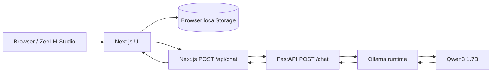

<div align="center">

# ZeeLM

### Local-first AI workspace for product thinking, engineering, and research

**Next.js · React · TypeScript · FastAPI · Python · Ollama · Qwen3 1.7B**

[Get started](#quick-start) · [Architecture](#architecture) · [Features](#features) · [Documentation](#documentation) · [Troubleshooting](#troubleshooting)

</div>

> **Project status:** Local development prototype. ZeeLM is designed to run on a developer's own machine; this repository does **not** host a publicly accessible model or live demo.

ZeeLM is a full-stack AI workspace that joins a polished, blue-illumination interface with a locally served language model. It is built for people who switch between product discovery, technical design, implementation, and research while retaining conversation context in the browser.

## At a glance

| Area | Implementation |
|---|---|
| Interface | Next.js App Router, React, TypeScript, CSS, responsive sidebar |
| Model serving | Ollama serving `qwen3:1.7b` locally |
| Backend | FastAPI, Pydantic, async Ollama client |
| Request flow | Browser → Next.js `/api/chat` → FastAPI `/chat` → Ollama |
| Content | Markdown responses, conversation history and workspace context |
| Persistence | Browser `localStorage` for conversations (no cloud database) |
| Model experimentation | Separate ZeeLM V4.1 experimental training work; **not** the chat-serving model |

## Features

- **Five workspaces:** AI Assistant, Product Studio, Engineering Lab, Research Desk, and Model Lab.
- **Private-by-default local inference:** responses from a Qwen3 model served through Ollama rather than a hosted model endpoint.
- **Conversation management:** create, select, rename, archive, unarchive, move to Recently Deleted, restore, and permanently delete chats.
- **Recovery window:** chats moved to Recently Deleted can be restored within 30 days; expired entries are removed by the app during its normal load/save lifecycle, not by a background task.
- **Responsive studio layout:** Blue Illumination artwork, collapsible history groups, floating conversation actions, and a persistent composer.
- **Full-stack interface:** same-origin Next.js API route forwards requests to FastAPI, which communicates with Ollama.

> **Data note:** Conversation data is browser-local. Clearing the browser's site data or changing browser profiles can remove it. This is **not** encrypted server-side persistence. Treat the project as a development prototype, not a multi-user production service.

## Architecture



The V4.1 training experiment is separate from this request path. Details: [docs/ARCHITECTURE.md](docs/ARCHITECTURE.md).

## Quick start

### Prerequisites

- Windows PowerShell and VS Code (the documented development environment)
- Node.js and npm compatible with the project's `frontend/package.json`
- Python and a virtual environment
- [Ollama](https://ollama.com/) installed, with the [`qwen3:1.7b`](https://ollama.com/library/qwen3) model downloaded

### 1 — Clone the source

After creating your repository, replace `YOUR_GITHUB_USERNAME` below with your actual account name:

```powershell
git clone https://github.com/YOUR_GITHUB_USERNAME/zeelm.git
cd zeelm
```

For an existing local checkout, skip cloning and open the project root instead.

### 2 — Install and start the model

```powershell
ollama pull qwen3:1.7b
ollama list
```

Ollama must be running. Depending on your installation, it may run as a Windows background application; otherwise use `ollama serve` in a separate terminal.

### 3 — Start FastAPI

From the project root, using the existing virtual environment if one is present:

```powershell
# Only if you have not created a virtual environment already:
py -m venv .venv
.\.venv\Scripts\python.exe -m pip install -r .\backend\requirements-zeelm.txt
.\.venv\Scripts\python.exe -m uvicorn backend.app.main:app --host 127.0.0.1 --port 8000 --reload
```

If your checkout uses `backend/requirements.txt` instead, install that file; use the dependency file actually present. Verify the endpoints below.

### 4 — Start Next.js

Open a second PowerShell terminal:

```powershell
cd frontend
npm ci
npm run dev
```

If the project does not yet have a `package-lock.json`, use `npm install` rather than `npm ci`. Keep only one Next.js dev server active to avoid an unexpected port change.

### 5 — Open and test

| URL | Purpose |
|---|---|
| [http://localhost:3000](http://localhost:3000) | ZeeLM UI **when the dev server uses port 3000** |
| [http://127.0.0.1:8000/health](http://127.0.0.1:8000/health) | FastAPI health check |
| [http://127.0.0.1:8000/docs](http://127.0.0.1:8000/docs) | Interactive FastAPI / Swagger docs |
| [http://127.0.0.1:8000/openapi.json](http://127.0.0.1:8000/openapi.json) | OpenAPI contract |

Localhost links work only while the corresponding processes are running on **your** machine. If Next.js reports port 3001, open that port instead.

## API example

```powershell
$body = @{ message = 'Design a secure REST API'; history = @() } | ConvertTo-Json -Depth 5
Invoke-RestMethod -Uri 'http://127.0.0.1:8000/chat' -Method Post -ContentType 'application/json' -Body $body
```

Expected response shape:

```json
{"reply": "...model response...", "model": "qwen3:1.7b"}
```

The Next.js `/api/chat` proxy returns `{ "reply": "..." }`. The observed source snapshot uses FastAPI port **8000**; review the current source if you have changed that port.

## Project structure

```text
zeelm/
├── backend/
│   ├── app/
│   │   ├── __init__.py
│   │   └── main.py                  # FastAPI + Ollama chat integration
│   └── requirements-zeelm.txt      # Or requirements.txt in your checkout
├── frontend/
│   ├── public/images/blue-illumination.webp
│   ├── src/
│   │   ├── app/
│   │   │   ├── api/chat/route.ts     # Same-origin API proxy
│   │   │   ├── globals.css
│   │   │   ├── layout.tsx
│   │   │   └── page.tsx
│   │   ├── components/              # Sidebar, composer, messages, studio UI
│   │   └── lib/                     # Chat client, workspaces, conversation state
│   ├── package.json
│   └── package-lock.json            # When present
├── docs/
│   ├── ARCHITECTURE.md
│   ├── BUILD_GUIDE.md
│   ├── COMMAND_REFERENCE.md
│   └── GITHUB_PUBLISH.md
└── README.md
```

Other existing project files, experiments and backups may be present locally. The public repository should include only appropriate authored source and intentional assets—not virtual environments, cached builds, private data, or model weights.

## Validation

```powershell
cd frontend
npx --no-install tsc --noEmit
npx --no-install next build
```

Run the project's lint/test commands if configured. A previously shared terminal transcript showed a passing Next.js production build; contributors should run these checks again on the **published commit**. Manual acceptance steps are in [docs/BUILD_GUIDE.md](docs/BUILD_GUIDE.md).

## Documentation

| Guide | Description |
|---|---|
| [Architecture](docs/ARCHITECTURE.md) | Runtime boundaries, request flow, state and limitations |
| [Build guide](docs/BUILD_GUIDE.md) | Detailed VS Code setup, file map, implementation stages, and validation |
| [Command reference](docs/COMMAND_REFERENCE.md) | PowerShell, Python, npm, Git, checks and troubleshooting commands |
| [GitHub publishing](docs/GITHUB_PUBLISH.md) | Review, ignore rules, staging, remote, push and repository verification |

## Troubleshooting

<details>
<summary><strong>Next.js started on port 3001 instead of 3000</strong></summary>

Another process is listening on 3000. Stop the unused Next.js server, or use the exact URL displayed by the active terminal. Check listening processes with `Get-NetTCPConnection -LocalPort 3000 -State Listen` in PowerShell.

</details>

<details>
<summary><strong>The sidebar CSS change appears in Chrome but disappears after refresh</strong></summary>

DevTools Console style changes affect the live DOM only. Persist changes in the actual component or stylesheet, save them, and verify the running port and imported CSS. ZeeLM's history spacing was resolved by defining independent section containers; see the latest `Sidebar.tsx` and CSS in this repository.

</details>

<details>
<summary><strong>Cannot reach FastAPI / Ollama</strong></summary>

Verify that Ollama is running and contains `qwen3:1.7b`; then check the FastAPI health endpoint and the Next.js proxy's configured backend URL. A passing `/health` check does not by itself prove the model is ready.

</details>

<details>
<summary><strong>Where did my conversations go?</strong></summary>

Conversation state is stored in the browser's localStorage for this site and browser profile. Inspect Recent, Archived, and Recently Deleted; a deleted item is recoverable only until it expires. Clearing site data is not reversible through the app.

</details>

## Security and limitations

- Local-first is not the same as audited privacy or encryption. Review your machine, browser, model and network settings.
- The included reference implementation does not establish authentication, permissions, multi-user isolation, encrypted chat backups, or a cloud deployment.
- Only run locally trusted code and dependencies. Review `.gitignore` before pushing.
- Do **not** commit `.env` secrets, API keys, chat exports, private training datasets, checkpoint weights or personal backups.
- The experimental model training outputs are not evidence that ZeeLM serves that trained model; the live application serves Qwen3 via Ollama.

## Roadmap

- [ ] Reproducible automated component and end-to-end tests
- [ ] Export/import conversations and resilient storage
- [ ] Model selection and health visibility
- [ ] Streaming generation, cancellation, and user feedback
- [ ] Authentication and deployment architecture, if a remote edition is developed

## References

[Next.js](https://nextjs.org/docs) · [FastAPI](https://fastapi.tiangolo.com/) · [Ollama](https://ollama.com/) · [Qwen3 model library](https://ollama.com/library/qwen3) · [TypeScript](https://www.typescriptlang.org/docs/) · [Git documentation](https://git-scm.com/docs)

---

**Maintained as a portfolio and engineering-learning project.** The GitHub repository URL will become available in the address bar once this source has been pushed to GitHub. No public deployment is claimed.
