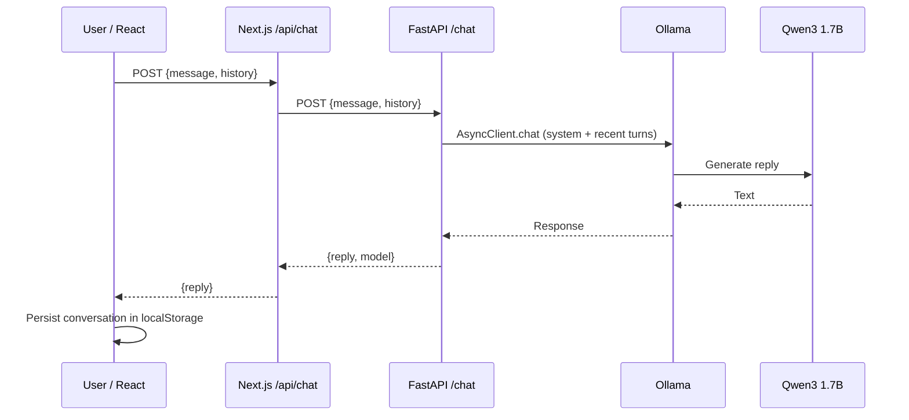

# ZeeLM architecture and API contracts

[← Back to README](../README.md)

## 1. Runtime boundaries



The consolidated source snapshot (`ZeeLM_Final_Fullstack_Backup_Release.zip`) defines the Next.js proxy and FastAPI implementation below. The later V2.6 conversation-recovery patch and sidebar rebuild alter the frontend; the developer's working tree is authoritative for exact current source.

## 2. API contracts

### `GET http://127.0.0.1:8000/`

Returns a JSON service description with model name and status in the referenced source.

### `GET http://127.0.0.1:8000/health`

Successful example: `{"status":"ok","service":"zeelm"}`.

### `POST http://127.0.0.1:8000/chat`

Request example:

```json
{
  "message": "How should we design the endpoint?",
  "history": [
    {"role": "user", "content": "We use FastAPI"},
    {"role": "assistant", "content": "Understood"}
  ]
}
```

The reference Pydantic model accepts a nonempty `message` of up to 12,000 characters and a `history` array of up to 30 entries. Each history content entry has a 12,000-character maximum. The backend forwards at most 12 recent valid user/assistant turns to Ollama. In the captured source, model options include `think=False`, `num_predict=384`, `num_ctx=2048`, `temperature=0.4`, and `keep_alive=5m`. Treat these as snapshot-specific, not immutable project requirements.

Response example:

```json
{"reply": "...", "model": "qwen3:1.7b"}
```

Invalid input is rejected (typically HTTP 422 by Pydantic). When Ollama is unavailable, the reference implementation returns HTTP 503. The frontend proxy may surface backend issues as HTTP 502 or 503.

### `POST /api/chat`

Same-origin Next.js route, accepts `{message, history}`, proxies to the backend and returns `{reply}` to browser callers. The referenced route uses `http://127.0.0.1:8000/chat` and a 120-second request timeout.

## 3. Key code paths

| File | Responsibility |
|---|---|
| `backend/app/main.py` | API schemas, health route, Ollama request, error handling |
| `frontend/src/app/api/chat/route.ts` | Input validation and backend proxy |
| `frontend/src/lib/chat-api.ts` | Client fetch wrapper |
| `frontend/src/lib/conversations.ts` | Conversation types and browser persistence |
| `frontend/src/lib/studio-data.ts` | Workspace metadata |
| `frontend/src/components/ChatWorkspace.tsx` | UI state orchestration |
| `frontend/src/components/Sidebar.tsx` | Workspace navigation, conversation list and actions |
| `frontend/src/components/Composer.tsx` | Message input |
| `frontend/src/components/MessageBubble.tsx` | Response rendering |
| `frontend/src/components/StudioHome.tsx` | Landing experience |
| `frontend/src/app/globals.css` | Global visual system and responsive styles |
| `frontend/public/images/blue-illumination.webp` | Static blue flowing image (not a video) |

## 4. Data lifecycle

- The consolidated source uses localStorage key `zeelm.studio.v2.conversations`.
- The later V2.6 patch preserves that key while adding `deletedAt` soft-delete behavior.
- Recent conversations exclude archived and deleted items. Archived excludes deleted items. Recently Deleted includes records with `deletedAt`.
- Recovery is available for 30 days; cleanup runs when the application loads/saves data, not continuously in the background.
- No hosted backend conversation database is evidenced by the inspected snapshot.
- Browser localStorage is origin-scoped; accessing `localhost:3000` versus `localhost:3001` uses separate origins and therefore separate storage.

## 5. Architecture trade-offs

**Advantages:** Local inference, simple separations of concern, no requirement for a cloud database, easy API inspection in FastAPI docs.

**Trade-offs:** Browser-bound history, local Ollama availability and device performance, lack of streaming and multi-user auth in the referenced baseline. Public deployment would require a deliberate security and infrastructure redesign.

## 6. Training distinction

ZeeLM V4.1 is a separate, experimental model-training effort. Its tracked training outcomes/checkpoints should not be described as production-serving the app. The current serving path routes to Ollama's `qwen3:1.7b`.
